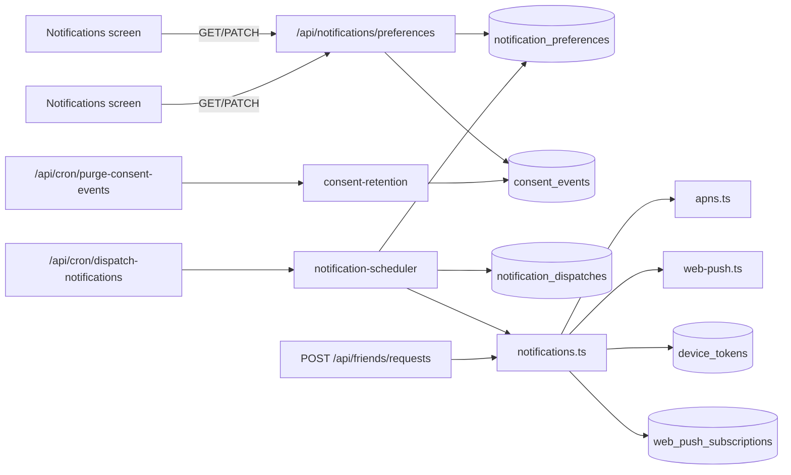

# Notifications

Still Point delivers remote push notifications via **APNs** (iOS) and **Web Push** (browser). User-facing schedules and opt-in live in `notification_preferences`; the server dispatches scheduled types on a cron and records sends in `notification_dispatches` for idempotency.

## Architecture



## Database

| Table | Purpose |
|-------|---------|
| `notification_preferences` | One row per user: master `push_enabled`, per-type flags, reminder time/frequency, quiet hours, missed-sit call opt-in (`call_opt_in`, `call_phone_number`, `call_consent_at`, `call_window_start`, `call_window_stop`), IANA `tz`, `friend_request_notifications_enabled`, `suppress_during_session`, `session_active_until` (#709 server-side session signal, not user-editable) |
| `notification_dispatches` | Unique `(user_id, notification_type, window_key)` — claim before send so cron retries do not double-send |
| `call_attempts` | Outbound missed-sit Vapi call log (#599): phone, window key, status, optional `vapi_call_id` |
| `consent_events` | Append-only consent log (#674): `user_id`, `channel` (`call` \| `sms`), `phone_number`, `event` (`granted` \| `revoked`), `disclosure_version`, `method`, `ip`, `created_at`. Opt-out appends `revoked` and does not delete prior rows. Purged by the daily retention job (see [Consent retention purge](#consent-retention-purge-789)). |
| `web_push_subscriptions` | Browser push endpoints (#347) |

Migrations: `drizzle/notification_preferences_345_incremental.sql`, `drizzle/web_push_subscriptions_347_incremental.sql`, `drizzle/notification_preferences_friend_request_359_incremental.sql`, `drizzle/notification_preferences_suppress_during_session_431_incremental.sql`, `drizzle/notification_preferences_dispatch_idx_531_incremental.sql`, `drizzle/notification_preferences_call_window_599_incremental.sql`, `drizzle/call_attempts_599_incremental.sql`, `drizzle/notification_preferences_session_active_709_incremental.sql`, `drizzle/notification_preferences_consent_events_674_incremental.sql`.

## API

### `GET /api/notifications/preferences`

Returns defaults (created on first read) for the authenticated user.

### `PATCH /api/notifications/preferences`

Partial update. Supported fields:

- `pushEnabled`, `dailyReminderEnabled`, `missADayEnabled`, `friendRequestNotificationsEnabled`, `suppressDuringSession`, `callOptIn` (boolean)
- `callPhoneNumber` (E.164, e.g. `+15551234567`), `callWindowStart`, `callWindowStop` (`HH:MM` 24h; window fields nullable)
- `dailyReminderTime`, `quietHoursStart`, `quietHoursEnd` (`HH:MM` 24h; quiet hours nullable)
- `dailyReminderFrequency`: `daily` | `every_other` | `weekly`
- `tz`: IANA timezone string

Quiet hours: `quietHoursStart` and `quietHoursEnd` must be updated together (or both set to `null`).

Call opt-in: `callOptIn: true` requires `callPhoneNumber` plus `callWindowStart` and `callWindowStop` (updated together). A false→true transition appends a `consent_events` row (`channel: call`, `event: granted`, `method: preferences_api`) and sets `callConsentAt` to that time. Changing `callPhoneNumber` while already opted in appends another `granted` row for the new number and refreshes `callConsentAt`. A true→false transition appends `event: revoked` and leaves `callConsentAt` in place (it is a cache of the latest grant, not proof that consent is still active — `callOptIn` is). The preference update and the audit insert run as one statement, and only if `call_opt_in` and `call_phone_number` are still the values that decision used. `disclosure_version` is null until a versioned disclosure exists. Backfill does not copy the current phone number, because it may not be the number that was consented. Call window fields must differ (`start !== stop`).

`GET /api/notifications/preferences` still returns `callConsentAt` as an ISO timestamp or `null`.

Consent events are kept for at least five years after the latest event for that user and channel. Opt-out does not delete them. The window is enforced by the daily `purge-consent-events` cron job (#789, [Consent retention purge](#consent-retention-purge-789)): it deletes a `(user_id, channel)` group only once that group's latest event is a revocation more than five years old, so it never touches a group that is still inside the window or whose consent is still granted. Deleting the account removes them immediately (`consent_events.user_id` cascades from `users`). SMS may use the same table later; this path only writes `channel: call`.

### `POST /api/notifications/session-state`

Authenticated. Body `{ "active": boolean }`. Reports whether a sit is running so the
server withholds this user's pushes for the duration (#709). `active: true` stores a
TTL-bounded `session_active_until`; `active: false` clears it. Ignored (stored as
`NULL`) for users who turned "Silence during sessions" off. Clients refresh on a 60s
heartbeat while the sit runs. Does not bump `updated_at` — a heartbeat is not a
preference edit.

### Web Push device registration

- `GET /api/notifications/push/subscription` — VAPID public key
- `POST|DELETE /api/notifications/push/subscription` — register/unregister browser subscription

### iOS device registration

`POST|DELETE /api/device-token` (unchanged from #203).

## Configuration

The dispatcher needs provider credentials **in every environment that runs the cron** (Production, and any Preview that dispatches). APNs requires all four of `APNS_BUNDLE_ID`, `APNS_TEAM_ID`, `APNS_KEY_ID`, `APNS_PRIVATE_KEY`; Web Push requires the `WEB_PUSH_VAPID_*` set. Missing any APNs var makes `getApnsConfig()` throw before a request reaches Apple.

Because a thrown provider-config error is caught per-token and never re-raised, a misconfigured environment fails **silently** — the cron still returns `200 {ok:true, sent:0}`. That left every scheduled iOS push undelivered for weeks (#621: `APNS_BUNDLE_ID` was simply unset in Production). Two guards now make that state visible:

- `getApnsConfigStatus()` (`src/lib/apns.ts`) is a non-throwing presence check. `sendPushNotificationToUser` preflights it and, when unconfigured, logs one actionable line naming the missing vars and skips the send — the device token is left enabled (a config error is not an APNs rejection).
- `/api/cron/dispatch-notifications` returns `apnsConfigured` (and `apnsMissing` when false) in its JSON, so the config state is visible at a glance instead of hidden behind a 200.

## Notification types

| Type | Issue | `notification_type` | Deep link (iOS) | Preference gate |
|------|-------|---------------------|-----------------|-----------------|
| Miss a day | #247 | `miss_a_day` | `stillpoint://session/quick` | `pushEnabled` + `missADayEnabled` |
| Daily practice reminder | #346 | `daily_reminder` | `stillpoint://home` | `pushEnabled` + `dailyReminderEnabled` + quiet hours + frequency |
| Friend request | #359 | `friend_request` | `stillpoint://home` | `pushEnabled` + `friendRequestNotificationsEnabled` |
| Failure-reason reminder | #441 | `failure_reason_reminder` | `stillpoint://log-reason?date=YYYY-MM-DD` | `pushEnabled` + `failureReasonReminderEnabled` |
| Missed-sit phone call | #599 | `missed_sit_call` | _(outbound Vapi call — no push)_ | `callOptIn` + phone + `[callWindowStart, callWindowStop]` |

Miss-a-day wins over daily reminder when both would fire in the same cron window (user missed yesterday and has not sat today).

### Missed-sit phone call (#599)

- Opt-in off by default; requires E.164 phone + local call window `[X, Y]`
- Hourly outbound Vapi calls from X through Y while the user has not completed a qualifying sit that local day
- Completing any qualifying sit cancels remaining calls for that day
- Idempotency `window_key` = `{localDate}T{hour}` (hour-granular, e.g. `2026-05-29T18`)
- Attempts logged in `call_attempts`; Vapi env vars (`VAPI_API_KEY`, `VAPI_ASSISTANT_ID`, `VAPI_PHONE_NUMBER_ID`) required for live calls only

### Miss-a-day (#247)

- Fires in the user's daily reminder window when they have **not** completed a session today and **did not** complete one yesterday (local dates)
- Uses `window_key` = local `YYYY-MM-DD` and type `miss_a_day`
- Helper: `sendMissADayNotification` (APNs + Web Push)

### Daily reminder (#346)

- Window key: local `YYYY-MM-DD` (or `YYYY-Www` for weekly frequency)
- Helper: `sendDailyReminderNotification` (streak-aware copy + APNs/Web Push)
- Skipped when user already completed a session today, or a `miss_a_day` dispatch exists for the same local date

### Friend request (#359)

- Event-driven on `POST /api/friends/requests`
- Helper: `sendFriendRequestNotification` (APNs + Web Push)

### Failure-reason reminder (#441)

- Fixed **8 PM local** trigger, independent of `dailyReminderTime`
- Helper: `sendFailureReasonReminderNotification` (yesterday-first catch-up framing)
- Deep link: `/app/log-reason?date=…` (web) / `stillpoint://log-reason?date=…` (iOS)
- Idempotency `window_key` = local firing date (not the day being asked about)
- Skipped when user completed a session or logged a failure reason for the target day

## Suppress during session (#431, #709)

`suppress_during_session` (**default true** since #709) holds Still Point's own
notifications while a sit is in progress. It is an **opt-out**: the "Silence
during sessions" toggle stays on both Settings screens for users who want
reminders regardless.

Two layers, because neither is sufficient alone:

### Layer 1 — server withholds the send (#709)

Clients report session state to `POST /api/notifications/session-state`
(`{ active: boolean }`), which stores `notification_preferences.session_active_until`
= now + `SESSION_ACTIVE_TTL_MS` (3 min, `src/lib/notifications/session-active.ts`).
Clients refresh on a 60s heartbeat while the sit runs and clear the column when it
ends. A TTL rather than a boolean means a client that stops reporting (tab killed,
app suspended, network drop) self-heals instead of muting the user indefinitely.

- The write is gated on `suppress_during_session`, so an opted-out user is never
  tracked. `isSessionActive()` re-checks the preference on read too, so toggling it
  off takes effect immediately rather than at the end of the current sit.
- **Enforcement is at the choke point:** `fanOutToUser()` in `src/lib/notifications.ts`
  checks `isUserSessionActive()`, so every send helper — and any added later —
  inherits the hold. `dispatchDueNotifications()` additionally skips active-session
  users before claiming a dispatch row, keeping the ledger clean, and skips
  missed-sit **calls** for the same reason (a ringing phone mid-sit is the loudest
  interruption we own). The call path checks **twice**: once against the candidate
  scan, then again with a fresh `isUserSessionActive()` read immediately before
  dialing, releasing the claim if a sit started in between. A push that slips
  through still meets the #431 display layer; a ringing phone has no such fallback,
  so the re-read is the only thing that can stop it.
- **Reminders are held, not queued.** A cron reminder skipped mid-sit is re-evaluated
  on the next tick, which only re-sends if the 5-minute window is still open — a sit
  spanning the whole window drops that day's reminder. That is the intended trade:
  the user is doing the thing the reminder asks for, and `userCompletedSessionOnDate`
  suppresses it afterwards anyway. Missed-sit call slots are hourly, so a held call
  is dropped rather than deferred.
- Only this layer can cover a push that arrives while the iOS app is backgrounded
  (`willPresent` never runs) or during a service-worker cold start — the banner is
  already on screen by the time a client-side check could run.
- Reports are **serialized per client** (`reportSessionActiveState` on web, the
  report queue in `SessionNotificationSuppressionController` on iOS) so an in-flight
  heartbeat cannot land after the clear that ended the sit and re-suppress for a
  full TTL. iOS coalesces the queue **newest-wins** rather than chaining every
  report: `APIClient`'s request timeout is no shorter than the 60s heartbeat, so a
  chain on a slow network took one full request per stacked heartbeat to reach the
  ending `false`.
- **The queue is reset at the auth boundary.** Web sign-out is an in-page state
  reset rather than a reload, so a report queued by one account would otherwise
  drain under the next account's cookie and silence the wrong user; the web queue
  carries an epoch that logout bumps, and `clearSuppressPreference()` on iOS
  cancels anything queued or in flight.
- **Known bound — one signal per user, not per device.** With two clients in a
  session view simultaneously, whichever finishes first clears the hold and the
  still-sitting client re-establishes it on its next heartbeat (≤60s exposure). A
  client only sends `active: false` if it previously sent `active: true`, so an idle
  client never clears another's hold. Per-device leases were judged not worth the
  extra storage and client-identity plumbing for a one-person-one-sit product.

### Layer 2 — client display suppression (#431)

Kept as a second layer for anything already in flight when the sit starts.

- **Web:** `SessionView` relays the desired state (`prefOn && sessionActive`) to
  the service worker over a `BroadcastChannel`
  (`stillpoint-session-suppression`). `public/sw.js` keeps the latest flag
  (also persisted in Cache Storage so a push that cold-starts the worker still
  honors it) and skips `showNotification` while suppression is active. The pref
  is mirrored from the server row into `localStorage`
  (`src/lib/sessionSuppressionPrefs.ts`) so the in-progress page can read it
  without a network round-trip — the same pattern as the wake-lock pref (#317).
  - *Tradeoff:* the Push API mandates `userVisibleOnly`, so a browser may
    eventually show a generic background notice or trim the push budget if many
    pushes are dropped silently. Layer 1 keeps that rare — the push is usually
    never sent — and suppression is scoped to the short window of an active sit.
- **iOS:** `SessionNotificationSuppressionController` tracks the cached preference
  plus local/buddy session-active state (parity with `SessionIdleTimerController`),
  and owns the server heartbeat above. `PushNotificationCoordinator.willPresent`
  returns empty presentation options (no banner/sound) when a sit is in progress
  and the preference is on. The preference is cached in `UserDefaults` (defaulting
  to **on** for an unset key) so `willPresent` works before the Notifications
  screen is opened.

A paused sit still counts as "in session" on both platforms, so reminders stay
held until the sit truly completes or is abandoned.

**Not covered:** other apps' notifications. Only a system Focus mode can silence
those — an app cannot suppress notifications it did not send.

## Scheduler

- **Route:** `GET|POST /api/cron/dispatch-notifications`
- **Schedule:** every 5 minutes (`vercel.json` crons)
- **Auth:** `Authorization: Bearer $CRON_SECRET` (required in production)
- **Window:** matches users whose local reminder time falls within the last 5 minutes (including windows that cross local midnight)
- **Quiet hours:** skipped when local time is inside the configured range (overnight ranges supported)
- **Frequency:** `daily` = one send per local date; `every_other` = even day index; `weekly` = Mondays (local)
- **Dedup:** `claimNotificationDispatch` is the source of truth per `(user_id, notification_type, window_key)`
- **Missed-sit calls:** separate candidate query for `call_opt_in` users; cron JSON includes `callsInitiated` and `callCandidatesScanned`
- **DST spring-forward gap (#531):** reminders scheduled inside the skipped local hour on spring-forward night (e.g. 02:30 `America/New_York`) are not delivered — cron ticks land at 01:55 then 03:00, both outside the 5-minute window. This is a once-per-year-per-timezone edge case; no catch-up pass is implemented yet.

### Consent retention purge (#789)

- **Route:** `GET|POST /api/cron/purge-consent-events`, implemented by `purgeExpiredConsentEvents()` in `src/lib/consent-retention.ts`
- **Schedule:** daily at 04:00 UTC (`vercel.json` crons)
- **Auth:** `Authorization: Bearer $CRON_SECRET` (required in production) — the same `isAuthorizedCron` check as the dispatcher (`src/lib/api/cronAuth.ts`)
- **Rule:** deletes every row of a `(user_id, channel)` group only when the group's latest `created_at` is more than five years (`CONSENT_RETENTION_YEARS`) before the run **and** that latest event is `revoked`. A group with any event inside the window keeps all of its rows, older ones included. A group whose latest event is `granted` is consent still in force — opt-out always appends `revoked` — so it stays until the account is deleted, as does a group whose latest instant holds both a grant and a revocation.
- **Cutoff:** the run time minus five calendar years (UTC), strict: a group whose latest event is exactly at the cutoff stays. A Feb 29 run uses Feb 28, so nothing younger than five years is purged.
- **Idempotent:** one SQL statement, so a run deletes all of its groups or none. A rerun or a duplicate delivery deletes nothing new, an overlapping run skips rows already deleted, and a failed run leaves its rows for the next day's run.
- **Response:** `{ ok, cutoff, deletedEvents, purgedGroups }`

## Measuring effectiveness (#675)

`npm run report:notification-effectiveness` measures, for each nudge type over a trailing window, how often a completed sit followed the nudge on the same local practice day. It also gives a baseline: the same users' sit rate with and without a nudge. It answers whether the channels we already ship change sit rates, before a fourth channel (SMS, #672) is considered. The code is in `src/lib/notifications/effectiveness.ts` and the CLI is `scripts/report-notification-effectiveness.ts`.

| Term | Meaning |
|------|---------|
| Day | The user's local practice day: the row's `window_key` date, matched to `sessions.session_date`. A weekly reminder's `YYYY-Www` key is that week's Monday. A call's `YYYY-MM-DDTHH` key is the day of that slot. No timestamp is converted to a date. |
| Sent | Push (`daily_reminder`, `miss_a_day`, `failure_reason_reminder`): a `notification_dispatches` row. The row survives only if at least one device accepted the push. Call (`missed_sit_call`): a `call_attempts` row with status `initiated`. Ledger `missed_sit_call` rows are listed as not measured, because the scheduler keeps that claim when Vapi rejects the call. |
| Converted | A completed sit credited to that day and saved (`sessions.created_at`) at or after the day's first send of that type. Several calls on one day are one nudged day. |
| Conversion | Converted days ÷ nudged days, with a 95% Wilson interval. |
| Baseline | For the users who got the nudge at least once: the sit rate on their nudged days, and on their days with no nudge of any kind (from signup to the window end). Users who never got a type are not in its row at all. |
| Calls attempted but not placed | Days with a `failed` call attempt and no placed call. They are selected the same way as call days, so they are the closest thing to a holdout. They are not randomized. |

**Reading it.** The selection effect dominates the baseline. Every nudge is skipped once the day already has a sit, so days without a nudge lean toward days the user had already sat, and nudged days are by construction days not yet sat. The gap between the two sit rates is therefore not the lift a nudge causes. Only a holdout can measure that. The type rows also overlap (the "Shared days" column), so they are not independent effects. When a row's interval is wide or overlaps another row's, the sample cannot tell them apart. At today's user counts, that may itself be the answer #675 asks for.

**Running it against production.** The script runs only SELECTs and prints only aggregates, with no user ids, so its Markdown can go straight into a comment on #675. Read-only database access is enough. Pass the URL inline so it stays out of `.env` files:

```bash
POSTGRES_URL="$(npx neonctl connection-string --project-id <production project id>)" \
  npm run report:notification-effectiveness -- --days 28
```

- `--days N` (default 28) and `--end YYYY-MM-DD` set the window. The default end is two days before today (UTC), the last day that has closed in every timezone, including the 6:00 grace window. A later `--end` adds a warning to the output.
- `--json` prints the raw report instead of Markdown.
- To keep the queries off production, point it at a fresh Neon branch of production. The results match production as of the branch point.
- The connection host prints to stderr, so stdout is only the Markdown.

## Settings UI (#359)

- **iOS:** Settings → **Notifications** (`NavigationLink` → `NotificationsSettingsView`)
- **Web:** Settings → **Notifications** → `/app/settings/notifications`

Section order (parity): Push on this device → Daily practice reminder → Quiet hours → Missed-sit phone call → Miss a day → Friend activity → During sessions.

Master push off disables dependent controls in the UI and persists `pushEnabled: false` (and unsubscribes web push / disables iOS token as before). Other preference toggles are preserved while push is off.

## iOS tap handling

- `PushNotificationCoordinator` stores pending deep links until `RootView` wires handlers
- `stillpoint://home` → home
- `stillpoint://session` / `stillpoint://session/quick` → `AppViewModel.consumePendingSessionDeepLinkIfNeeded()`
- `stillpoint://log-reason?date=…` → native log-reason capture (`LogReasonView`)
- `stillpoint://friends` → friends surface (via notification deep-link handler)

## Adding a notification type

1. **Preference flag** — Add a boolean column on `notification_preferences` (migration + schema + PATCH validation).
2. **Send helper** — Add `sendXNotification()` in `src/lib/notifications.ts` (APNs + `sendWebPushToUser` where applicable).
3. **Scheduler branch** — In `src/lib/notification-scheduler.ts` for scheduled types, or event handler for instant types. Roll back the dispatch row if delivery fails.
4. **iOS + web** — Expose the flag on the Notifications screen; handle payload `type` / `deepLink` on tap.
5. **Tests** — Preference validation, scheduler gating, idempotent `claimNotificationDispatch`.
6. **Effectiveness** — If the type nudges a sit, add it to `LEDGER_NUDGE_TYPES` in `src/lib/notifications/effectiveness.ts`. Until then, the report lists its rows as not measured.

## Security

- Never log raw APNs device tokens or Web Push subscription keys.
- Cron endpoints must not be callable without `CRON_SECRET` in production. Each `/api/cron/*` route runs `isAuthorizedCron` (`src/lib/api/cronAuth.ts`) and is listed in `publicExactPaths` in `src/middleware.ts`, whose JWT check would otherwise reject Vercel's `Bearer $CRON_SECRET`.

## Related issues

- #203 — APNs + `device_tokens`
- #345 — Notification preferences foundation
- #346 — Daily reminder
- #347 — Web Push channel
- #247 — Miss-a-day notifications
- #359 — Unified Notifications settings screen
- #431 — Suppress notifications during a meditation session
- #709 — No notifications during a session (server-side hold + on by default)
- #599 — Missed-sit outbound Vapi phone calls
- #674 — Append-only `consent_events` log
- #789 — Five-year `consent_events` retention purge
- #675 — Nudge effectiveness report
